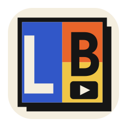
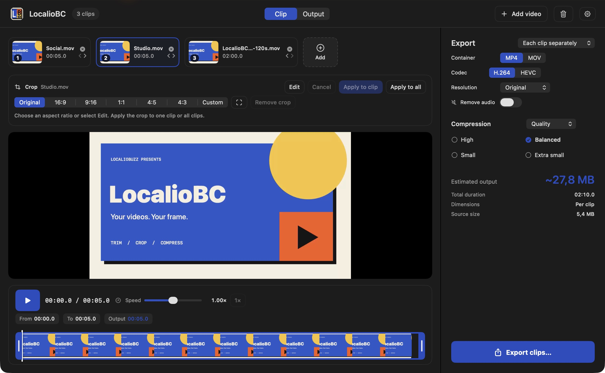
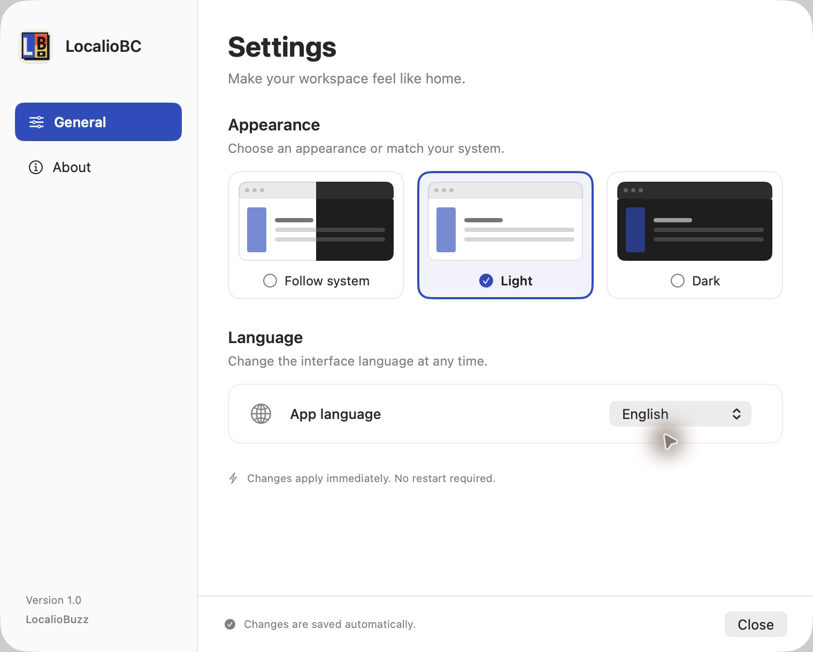

<p align="center">
  
</p>

# LocalioBC

**A free, open-source video editor for macOS. Trim, crop, merge and compress videos entirely on your Mac.**

No subscriptions, ads, watermarks, accounts or uploads. Built with SwiftUI, AppKit and AVFoundation. Part of the LocalioBuzz family.



## Download for macOS

[**Download LocalioBC 1.2.0 for Mac**](https://github.com/bradacz/LocalioBC/releases/download/v1.2.0/LocalioBC-1.2.0-universal.dmg) · [All releases](https://github.com/bradacz/LocalioBC/releases)

Requires **macOS 14 or later**. One universal DMG supports **Apple Silicon and Intel**. Open the disk image, drag **LocalioBC.app** into **Applications**, then eject the image and launch the app.

Public release builds are Developer ID signed and Apple notarized. A SHA-256 checksum is provided with the release.

## Features

- **Import:** drag and drop MP4, MOV and M4V files, or use the file picker.
- **Speed:** use a continuous 0.25×–4× slider, with 1× at its center, a precise readout and a reset button. Preview and exports use the same speed, update duration/size estimates, and keep audio synchronized. Audio pitch changes with speed.
- **Trim:** adjust clip beginnings and endings on a thumbnail timeline with precise seeking.
- **Crop:** use 16:9, 9:16, 1:1, 4:5, 4:3 or a custom frame. Move or resize the frame, then apply or cancel your changes.
- **Batch crop:** apply to one clip or every clip. Presets preserve aspect ratio, relative zoom and position across different dimensions and orientations; custom crops use relative image coordinates.
- **Merge:** reorder clips and combine videos with different dimensions, frame rates and orientations. The first clip determines the output canvas; other clips are fitted inside it.
- **Separate export:** save every clip as its own file with its own trim and crop. Files go into a new, uniquely named subfolder with numbered names to avoid collisions.
- **Formats:** export MP4 or MOV with H.264 or HEVC, at original resolution or with 1080p, 720p or 480p long-edge limits.
- **Compression:** choose a quality preset or a target size in decimal MB. The estimate reflects the encoder's bitrate limits; impossible size targets are rejected. In separate mode, the target applies to **each clip**.
- **Lossless mode:** copy compatible single-clip video without re-encoding when no image crop, speed edit or resolution change is needed. Trimming may depend on source keyframes. Incompatible containers fall back to encoding.
- **Audio removal:** remove audio tracks from exported files, including compatible lossless exports, and mute playback previews.
- **Preview:** switch between the source clip and the composed output before exporting.
- **Export controls:** view progress, cancel, reveal output in Finder or open the result. Cancelling a batch keeps files that have already finished.
- **Preferences:** Czech or English, plus light, dark or system appearance. Settings apply immediately and persist between launches.
- **Updates:** the direct edition includes optional daily checks and automatic downloads through Sparkle. Signed updates install after processing finishes and confirmation of closing in-memory edits. Native update dialogs follow the selected language after relaunch. The Store edition updates through Apple.
- **About:** feature overview, license, project links and contact information.

## Quick start

1. Import one or more clips.
2. Select a clip and adjust its trim range. Drag the **Speed** slider beside the play controls, or use **1×** to reset it.
3. Choose a crop preset or **Edit**, adjust the frame, then select **Apply to clip** or **Apply to all**. The crop panel stays visible so opening it does not move the video preview.
4. Choose **Merge into one video** or **Each clip separately** in the output panel.
5. Set the container, codec, resolution, audio and compression options.
6. Select **Export video…** or **Export clips…**. The export button remains visible at the bottom of the sidebar.

Open the gear icon to change language and appearance or read about the app. Keyboard shortcuts: **⌘O** to import, **⌘E** to export and **⌘,** for settings.

## Preferences

A dedicated settings panel provides a fixed navigation sidebar, visual appearance choices, immediate language switching and a structured About page. Preferences are saved automatically.



[View the dark appearance](docs/screenshots/settings-en-dark.png).

## Build from source

Requires **macOS 14 or later** and **Xcode 16 or later with Swift 6**. Development and tests are verified with Xcode 26.3. Xcode resolves the pinned **Sparkle 2.10.1** binary package for the direct target. The separate Store target has no Sparkle dependency; `Package.resolved` is committed.

```sh
git clone https://github.com/bradacz/LocalioBC.git
cd LocalioBC
open LocalioBC.xcodeproj
```

Select the **LocalioBC** scheme and run. The project uses local ad-hoc signing for development. App Store distribution or notarized distribution requires your own signing configuration.

Command-line build and tests:

```sh
xcodebuild -project LocalioBC.xcodeproj -scheme LocalioBC \
  -configuration Debug -derivedDataPath /tmp/LocalioBC-build build

xcodebuild -project LocalioBC.xcodeproj -scheme LocalioBC \
  -configuration Debug -derivedDataPath /tmp/LocalioBC-build \
  -test-timeouts-enabled YES -default-test-execution-time-allowance 30 \
  -maximum-test-execution-time-allowance 60 test
```

## Project layout

- `Models/` — clip metadata, export settings, appearance, language and localization helpers.
- `Services/` — video inspection, timeline composition and export pipelines.
- `ViewModels/` — editor state, crop drafts, preview generation and cancellable batch exports.
- `Views/` — editor, timeline, crop overlay, export sidebar and settings/about UI.
- `Resources/` — Czech and English translations.
- `LocalioBCTests/` — synthetic media integration tests and state-management regressions.
- `Scripts/` — reproducible app-icon and screenshot-demo asset generators.

## Icon and screenshots

The icon follows the parent LocalioBuzz identity: cobalt blue, orange, golden yellow, cream, a bold LB monogram and an integrated video-play symbol. Its editable vector source is [docs/icon.svg](docs/icon.svg). Regenerate every macOS icon size with:

```sh
swift Scripts/generate-icon.swift
```

The English screenshot uses synthetic demonstration footage created for this repository, rather than personal videos. To generate the demo clip:

```sh
swift Scripts/generate-demo.swift /tmp/LocalioBC-demo.mov
```

Open that clip in the app and choose English in Settings before capturing a screenshot.

## Practical notes

Target sizes are estimates because variable-bitrate encoding and container overhead vary. HEVC support depends on the codecs available on the Mac. The lossless option preserves the source video codec; choosing a different codec requires normal encoding. Edits are held in memory for the current session; project save/load is not currently implemented.

## Links and contact

- [LocalioBuzz](https://www.localiobuzz.com)
- [MyLocalio](https://mylocalio.com)
- [GitHub repository](https://github.com/bradacz/LocalioBC)
- [info@mylocalio.com](mailto:info@mylocalio.com)

## License

[MIT](LICENSE). The direct/GitHub edition is free to use and build from source. A separately distributed Mac App Store edition is prepared as a EUR 4.99 one-time purchase; it remains open source.

## Build a distributable DMG

Packaging uses the optional development tool `dmgbuild`; it is not bundled with the app.

```sh
python3 -m venv /tmp/LocalioBC-dmg-tools
/tmp/LocalioBC-dmg-tools/bin/python -m pip install -r Scripts/requirements-dmg.txt

SIGN_IDENTITY='Developer ID Application: Your Company (TEAMID)' \
DEVELOPMENT_TEAM='TEAMID' \
NOTARY_PROFILE='your-keychain-profile' \
DMGBUILD_BIN=/tmp/LocalioBC-dmg-tools/bin/dmgbuild \
bash Scripts/build-dmg.sh
```

Use your own Developer ID certificate and an existing `notarytool` Keychain profile. Credentials stay in the Keychain and must never be committed. Packaging requires a real Developer ID identity. A public release also requires `NOTARY_PROFILE`; an image without notarization is rejected by the update-feed generator.

The script archives both architectures in Release mode and performs a Developer ID export, which signs Sparkle's nested helpers. It notarizes/staples the app, creates and notarizes/staples a branded DMG, then verifies both architectures, signatures and Gatekeeper acceptance. Artifacts and the checksum are written to `dist/`. Version/build defaults come from the project; `RELEASE_VERSION` and `BUILD_NUMBER` can override them for testing. Use a fresh output directory for each build.

## Mac App Store edition

**Status verified 15 November 2026, 00:13 CET:** Store version **1.0.0 (3)** is **Waiting for Review**, with manual release after approval. The public direct edition is **1.2.0 (6)**. Store source 1.2.0 (6) builds locally but has not been packaged, uploaded or submitted to Apple. See [current Store status](AppStore/STATUS.md).

The separate `LocalioBC-AppStore` target/scheme archives the paid Store configuration with sandboxing, a bundled privacy manifest and licence, and copy appropriate for a one-time purchase. It shares editing sources with the direct target, while physically excluding Sparkle, its helpers, update configuration and sandbox exceptions. Both archives and exported Store packages are checked for updater isolation. The public GitHub DMG remains the free direct edition.

The complete [submission kit](AppStore/README.md) includes English/Czech metadata, screenshots, reviewer instructions and original demo clips, privacy/compliance answers, export options and a repeatable build script. Pricing is prepared at **EUR 4.99**, with manual release after Apple approval. Account-side pricing and review submission are not performed by the scripts.

[Product website](https://localiobc.mylocalio.com/) · [Support](https://localiobc.mylocalio.com/support/) · [Privacy policy](https://localiobc.mylocalio.com/privacy/)

## Automatic updates

Version **1.2.0 is the first updater-enabled direct release**. Install it manually once if you use 1.1.0 or earlier. Later direct releases can update in the app. The [Mac App Store manages its own updates](https://developer.apple.com/app-store/review/guidelines/#hardware-compatibility).

- [Sparkle 2.10.1](https://sparkle-project.org/documentation/) supplies **Check for Updates…** in the app menu and Settings. Its native consent prompt offers daily checks and optional automatic downloads; preferences can be changed in Settings. System profiling is disabled. Video editing remains offline; update-check connection metadata is described in the privacy policy.
- The stable feed is `https://localiobc.mylocalio.com/updates/appcast.xml`. It points to immutable, versioned GitHub DMGs and embeds Czech/English markdown release notes inside the signed feed, avoiding a separate notes request or HTML player.
- Both the feed/notes and downloaded DMG require **Ed25519 signatures**. Downloads are verified before extraction; signature failures do not expire into acceptance. Apple Developer ID signing, hardened runtime and notarization provide a separate trust layer. Source files and edits are not sent in update requests.
- Updates defer while exporting, importing or building a preview. An installation waiting for the current session can be resumed from Settings. The ordinary quit path also confirms closing in-memory edits, including install-on-quit paths that bypass Sparkle's relaunch hook.
- The public key is in direct `Info.plist`; the private key stays in the login Keychain under account `com.localiolabs.LocalioBC.sparkle`. Keep an encrypted backup outside the repository. Loss of the signing key requires the documented Sparkle key-rotation procedure or a manually installed recovery release; never publish the private key.

Release order: tests → universal Archive/Developer ID export → notarization/stapling → verified final DMG → Sparkle signing → GitHub upload/verification → signed feed and website publication. Always increase `CFBundleVersion`. Correct a bad release using a higher build, with reverted source if needed.

After `build-dmg.sh` completes, generate the signed feed using the matching Sparkle tools from Xcode's `SourcePackages/artifacts/sparkle/Sparkle/bin`:

```sh
python3 Scripts/generate-update-feed.py dist/v1.2.0/LocalioBC-1.2.0-universal.dmg \
  --app dist/v1.2.0/export/LocalioBC.app \
  --tools-dir /path/to/SourcePackages/artifacts/sparkle/Sparkle/bin
```

The generator verifies Apple tickets, matches the Keychain public key to the app, signs the final payload, and signs the appcast with localized notes from `docs/releases/`. It refuses a feed downgrade or replacement of an existing build with different payload bytes. Upload and verify the DMG **before** committing/publishing the feed. Do not reformat signed XML, alter the DMG after signing, or enable CDN transformations that rewrite the feed. Verify served bytes and signatures after deployment. [Sparkle publishing guide](https://sparkle-project.org/documentation/publishing/).
