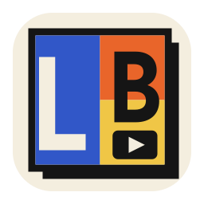
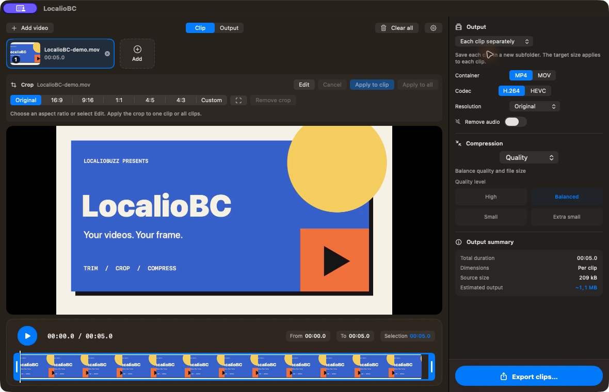
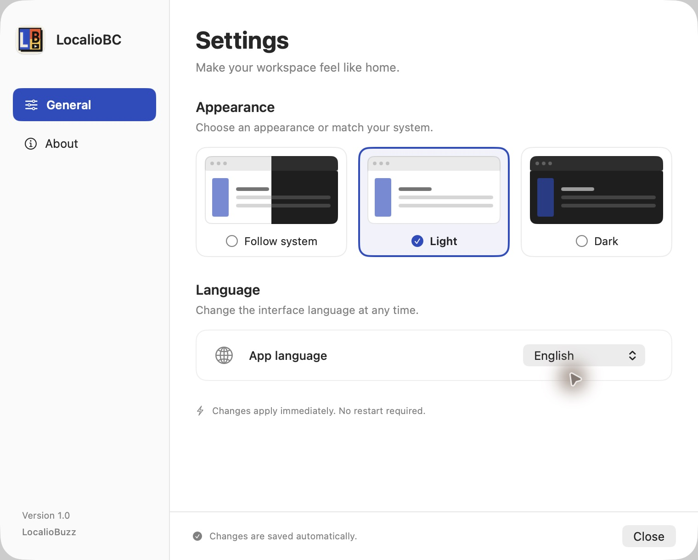

<p align="center">
  
</p>

# LocalioBC

**A free, open-source video editor for macOS. Trim, crop, merge and compress videos entirely on your Mac.**

No subscriptions, ads, watermarks, accounts or uploads. Built with SwiftUI, AppKit and AVFoundation. Part of the LocalioBuzz family.



## Download for macOS

[**Download LocalioBC 1.0.0 for Mac**](https://github.com/bradacz/LocalioBC/releases/download/v1.0.0/LocalioBC-1.0.0-universal.dmg) · [All releases](https://github.com/bradacz/LocalioBC/releases)

Requires **macOS 14 or later**. One universal DMG supports **Apple Silicon and Intel**. Open the disk image, drag **LocalioBC.app** into **Applications**, then eject the image and launch the app.

Public release builds are Developer ID signed and Apple notarized. A SHA-256 checksum is provided with the release.

## Features

- **Import:** drag and drop MP4, MOV and M4V files, or use the file picker.
- **Trim:** adjust clip beginnings and endings on a thumbnail timeline with precise seeking.
- **Crop:** use 16:9, 9:16, 1:1, 4:5, 4:3 or a custom frame. Move or resize the frame, then apply or cancel your changes.
- **Batch crop:** apply to one clip or every clip. Presets preserve aspect ratio, relative zoom and position across different dimensions and orientations; custom crops use relative image coordinates.
- **Merge:** reorder clips and combine videos with different dimensions, frame rates and orientations. The first clip determines the output canvas; other clips are fitted inside it.
- **Separate export:** save every clip as its own file with its own trim and crop. Files go into a new, uniquely named subfolder with numbered names to avoid collisions.
- **Formats:** export MP4 or MOV with H.264 or HEVC, at original resolution or with 1080p, 720p or 480p long-edge limits.
- **Compression:** choose a quality preset or a target size in decimal MB. The estimate reflects the encoder's bitrate limits; impossible size targets are rejected. In separate mode, the target applies to **each clip**.
- **Lossless mode:** copy compatible single-clip video without re-encoding when no image crop or resolution change is needed. Trimming may depend on source keyframes. Incompatible containers fall back to encoding.
- **Audio removal:** remove audio tracks from exported files, including compatible lossless exports, and mute playback previews.
- **Preview:** switch between the source clip and the composed output before exporting.
- **Export controls:** view progress, cancel, reveal output in Finder or open the result. Cancelling a batch keeps files that have already finished.
- **Preferences:** Czech or English, plus light, dark or system appearance. Settings apply immediately and persist between launches.
- **About:** feature overview, license, project links and contact information.

## Quick start

1. Import one or more clips.
2. Select a clip and adjust its trim range.
3. Choose a crop preset or **Edit**, adjust the frame, then select **Apply to clip** or **Apply to all**. The crop panel stays visible so opening it does not move the video preview.
4. Choose **Merge into one video** or **Each clip separately** in the output panel.
5. Set the container, codec, resolution, audio and compression options.
6. Select **Export video…** or **Export clips…**. The export button remains visible at the bottom of the sidebar.

Open the gear icon to change language and appearance or read about the app. Keyboard shortcuts: **⌘O** to import, **⌘E** to export and **⌘,** for settings.

## Preferences

A dedicated settings panel provides a fixed navigation sidebar, visual appearance choices, immediate language switching and a structured About page. Preferences are saved automatically.



[View the dark appearance](docs/screenshots/settings-en-dark.png).

## Build from source

Requires **macOS 14 or later** and **Xcode 16 or later with Swift 6**. Development and tests are verified with Xcode 26.3. There are no third-party package dependencies.

```sh
git clone https://github.com/bradacz/LocalioBC.git
cd LocalioBC
open LocalioBC.xcodeproj
```

Select the **LocalioBC** scheme and run. The project uses local ad-hoc signing for development. App Store distribution or notarized distribution requires your own signing configuration.

Command-line build and tests:

```sh
xcodebuild -project LocalioBC.xcodeproj -scheme LocalioBC \
  -configuration Debug -derivedDataPath /tmp/LocalioBC-build build

xcodebuild -project LocalioBC.xcodeproj -scheme LocalioBC \
  -configuration Debug -derivedDataPath /tmp/LocalioBC-build \
  -test-timeouts-enabled YES -default-test-execution-time-allowance 30 \
  -maximum-test-execution-time-allowance 60 test
```

## Project layout

- `Models/` — clip metadata, export settings, appearance, language and localization helpers.
- `Services/` — video inspection, timeline composition and export pipelines.
- `ViewModels/` — editor state, crop drafts, preview generation and cancellable batch exports.
- `Views/` — editor, timeline, crop overlay, export sidebar and settings/about UI.
- `Resources/` — Czech and English translations.
- `LocalioBCTests/` — synthetic media integration tests and state-management regressions.
- `Scripts/` — reproducible app-icon and screenshot-demo asset generators.

## Icon and screenshots

The icon follows the parent LocalioBuzz identity: cobalt blue, orange, golden yellow, cream, a bold LB monogram and an integrated video-play symbol. Its editable vector source is [docs/icon.svg](docs/icon.svg). Regenerate every macOS icon size with:

```sh
swift Scripts/generate-icon.swift
```

The English screenshot uses synthetic demonstration footage created for this repository, rather than personal videos. To generate the demo clip:

```sh
swift Scripts/generate-demo.swift /tmp/LocalioBC-demo.mov
```

Open that clip in the app and choose English in Settings before capturing a screenshot.

## Practical notes

Target sizes are estimates because variable-bitrate encoding and container overhead vary. HEVC support depends on the codecs available on the Mac. The lossless option preserves the source video codec; choosing a different codec requires normal encoding. Edits are held in memory for the current session; project save/load is not currently implemented.

## Links and contact

- [LocalioBuzz](https://www.localiobuzz.com)
- [MyLocalio](https://mylocalio.com)
- [GitHub repository](https://github.com/bradacz/LocalioBC)
- [info@mylocalio.com](mailto:info@mylocalio.com)

## License

[MIT](LICENSE). LocalioBC is open source and completely free to use.

## Build a distributable DMG

Packaging uses the optional development tool `dmgbuild`; it is not bundled with the app.

```sh
python3 -m venv /tmp/LocalioBC-dmg-tools
/tmp/LocalioBC-dmg-tools/bin/python -m pip install -r Scripts/requirements-dmg.txt

SIGN_IDENTITY='Developer ID Application: Your Company (TEAMID)' \
DEVELOPMENT_TEAM='TEAMID' \
NOTARY_PROFILE='your-keychain-profile' \
DMGBUILD_BIN=/tmp/LocalioBC-dmg-tools/bin/dmgbuild \
bash Scripts/build-dmg.sh
```

Use your own Developer ID certificate and an existing `notarytool` Keychain profile. Credentials stay in the Keychain and must never be committed. Without `NOTARY_PROFILE`, the script produces an unnotarized development image. Without `SIGN_IDENTITY`, it uses ad-hoc signing, which is not suitable for a trusted public release.

The script builds both architectures in Release mode, signs and notarizes the app, staples its ticket, creates a branded drag-to-Applications DMG, signs and notarizes the DMG, and verifies the packaged app and Gatekeeper acceptance. Artifacts and the checksum are written to `dist/`. Set `RELEASE_VERSION` to override the packaging version for a future release.
